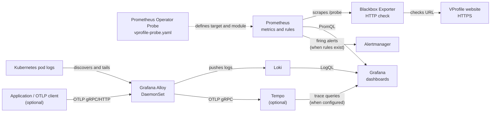

# Monitoring

This directory contains Kubernetes and Helm configuration for VProfile observability:
Prometheus metrics, synthetic HTTP checks, centralized pod logs, and optional traces.

- `monitoring-values.yaml` configures Grafana persistence, Prometheus retention and storage, and Alertmanager storage for the Prometheus Community `kube-prometheus-stack` chart.
- `loki-values.yaml` configures Loki as a single-replica, filesystem-backed monolith.
- `alloy-values.yaml` configures Grafana Alloy as a DaemonSet that collects Kubernetes pod logs and forwards them to Loki.
- `vprofile-probe.yaml` defines the Blackbox Exporter probe for the public VProfile URL.
- `vprofile-sre-slo-dashboard.json` is a Grafana dashboard for synthetic availability, latency, and error-budget indicators.
- `gce-vm-scrape.yaml` defines an optional Prometheus Operator `ScrapeConfig` for a VM Node Exporter.
- `alloy-values-tempo.yaml` configures optional OTLP trace collection and forwarding to Tempo.

## Prerequisites

- A Kubernetes cluster with `kubectl` configured to use it.
- Helm 3.
- A cluster storage class that can provision persistent volumes.
- The Prometheus Operator CRDs are installed by `kube-prometheus-stack`; custom `Probe` and `ScrapeConfig` resources depend on them.

## Install

Add the chart repositories and create the monitoring namespace:

```sh
helm repo add prometheus-community https://prometheus-community.github.io/helm-charts
helm repo add grafana https://grafana.github.io/helm-charts
helm repo update

kubectl create namespace monitoring --dry-run=client -o yaml | kubectl apply -f -
```

Install Prometheus, Loki, and Alloy:

```sh
helm upgrade --install prometheus prometheus-community/kube-prometheus-stack \
  --namespace monitoring \
  --values monitoring-values.yaml

helm upgrade --install loki grafana/loki \
  --namespace monitoring \
  --values loki-values.yaml

helm upgrade --install alloy grafana/alloy \
  --namespace monitoring \
  --values alloy-values.yaml
```

Alloy sends pod logs to `http://loki-gateway.monitoring.svc.cluster.local/loki/api/v1/push`.
The Loki gateway service must be reachable at that address for log delivery to work.

## Architecture and telemetry flow



### Metrics and synthetic checks

1. Prometheus discovers the `Probe` custom resource in the `monitoring` namespace.
2. Prometheus asks the Blackbox Exporter service to run the `http_2xx` module.
3. The exporter makes an HTTP request to `https://vprofile.latun.store` from inside the cluster and returns metrics to Prometheus.
4. Prometheus stores metrics such as `probe_success`, `probe_duration_seconds`, `probe_http_status_code`, and (when available) TLS certificate expiry.
5. Grafana queries Prometheus to display the SLI dashboard. Prometheus alerts can be routed through Alertmanager once alert rules and receivers are configured.

The check measures reachability from the monitoring cluster, not every user's experience or every application request. DNS, egress, TLS, and the website's response all affect the result. A failed check is an availability signal, not by itself a diagnosis of the cause.

### Logs and optional traces

- Alloy runs as a DaemonSet, discovers Kubernetes pods, collects their logs, and pushes them to Loki. Grafana can query those logs using LogQL.
- `alloy-values-tempo.yaml` adds OTLP receivers on ports 4317 (gRPC) and 4318 (HTTP) and forwards traces to `tempo.tempo.svc.cluster.local:4317`. This is an optional configuration; install and configure Tempo and instrument an application to emit OTLP traces before expecting trace data. Do not use the Tempo values file as the basic logging-only Alloy configuration.

The VProfile application exposes Actuator endpoint names in its application configuration, including `prometheus`. This is separate from the external Blackbox check: application metrics require the deployed app to serve `/actuator/prometheus` and Prometheus to be configured to scrape that endpoint. Verify the endpoint and scrape target before using application metrics; the supplied `Probe` only checks the public website.

## Monitor the VProfile website

The `vprofile-probe.yaml` manifest defines a Prometheus Operator `Probe` that uses the
Blackbox Exporter `http_2xx` module to check `https://vprofile.latun.store` every 30
seconds. Prometheus records the result as `probe_success` (1 for success, 0 for failure).

Install the Blackbox Exporter in the monitoring namespace after installing the Prometheus Operator:

```sh
helm upgrade --install blackbox prometheus-community/prometheus-blackbox-exporter \
  --namespace monitoring
```

The manifest expects the exporter service at
`blackbox-prometheus-blackbox-exporter.monitoring.svc.cluster.local:9115`. Apply the
probe after the Prometheus Operator CRD and exporter are installed. The release label
must match the Prometheus Helm release (`prometheus` in the install commands above),
so update `metadata.labels.release` in `vprofile-probe.yaml` from `monitoring` to
`prometheus` before applying:

```sh
kubectl apply -f vprofile-probe.yaml
```

Confirm the resource and exporter are available:

```sh
kubectl get probes -n monitoring
kubectl get pods,svc -n monitoring
```

In Prometheus, query:

```promql
probe_success{application="vprofile"}
```

`1` means the latest check succeeded; `0` means the check failed. A missing series
usually means the Probe was not selected, the exporter is unavailable, or Prometheus
has not scraped it. Check the Prometheus Targets page and the Prometheus/Blackbox pod
logs for more detail.

## SLI, SLO, and error budget

- **SLI (Service Level Indicator):** a measured reliability signal. The dashboard's availability SLI is the percentage of successful Blackbox checks (`probe_success`) over the selected 30-day window. Its latency SLI is the percentage of measured probe durations below 500 ms.
- **SLO (Service Level Objective):** a reliability target for an SLI. The dashboard uses **99.9% synthetic availability over 30 days** as a demo objective. It is not a contractual SLA, and a synthetic check is not equivalent to request-level availability.
- **Error budget:** the allowed unsuccessful portion of the objective window. At 99.9%, the budget is 0.1% of the window (43 minutes 12 seconds over 30 days). Repeated failures consume the budget; a negative remaining budget means the objective has been missed.

**Retention caveat:** `monitoring-values.yaml` currently retains Prometheus data for
7 days, while the dashboard queries a 30-day range. With the current retention, the
dashboard cannot show a complete 30-day SLI or error budget. To operationalize the
30-day objective, increase Prometheus retention to at least 30 days and size storage
for the additional data; otherwise, change the dashboard queries and objective window
to match the retained period. Missing samples are not proof of availability and
should be investigated separately.

The 500 ms latency panel is an indicator; it is not currently a separate latency SLO
target. Dashboard panels visualize SLIs and budget burn but do not create alerts. No
SLO alert policy or notification receiver is configured by these files. Before
treating the demo objective as an operational SLO, agree on the service boundary,
measurement window, exclusions, target, alert thresholds, and response runbook with
service owners.

### Import the SLO dashboard

In Grafana, open **Dashboards → New → Import**, upload `vprofile-sre-slo-dashboard.json`,
and select the Prometheus data source when prompted. The dashboard expects probe
series labeled `application="vprofile"`. Allow enough time for samples to accumulate;
the full 30-day panels will not represent a complete window immediately after setup.

## Access Prometheus and Grafana locally

Forward the service ports from a terminal:

```sh
kubectl port-forward --namespace monitoring svc/prometheus-kube-prometheus-prometheus 9090:9090
```

Open Prometheus at `http://localhost:9090`. In another terminal, forward Grafana:

```sh
kubectl port-forward --namespace monitoring svc/prometheus-grafana 3000:80
```

Open Grafana at `http://localhost:3000`. Use the credentials configured for the Helm release; do not commit credentials or secret overrides to this directory.

## Retention, storage, and operational notes

- Prometheus retains metrics for 7 days and requests a 10 GiB persistent volume.
- Grafana requests 5 GiB and Alertmanager requests 2 GiB of persistent storage.
- Loki is configured as one filesystem-backed replica with a 10 GiB persistent volume. This is a simple setup, not a highly available or object-storage-backed log architecture.
- Confirm that the cluster's default storage class can provision the requested volumes and monitor PVC capacity. Retention and storage sizes should reflect the workload and available disk.
- The Blackbox Exporter and VProfile URL must be reachable from the cluster. Keep credentials and private Helm overrides out of source control.
- The optional `gce-vm-scrape.yaml` targets a Node Exporter and requires the `ScrapeConfig` CRD, a matching Prometheus release label, and network access to the VM's exporter port. Review its target and labels for the current environment before applying it.

Useful checks:

```sh
helm list -n monitoring
kubectl get pods,pvc -n monitoring
kubectl get probes,scrapeconfigs -n monitoring
```

## Files

- `PortNumbers.png` and `PromQL+Intro.xlsx` are reference materials.
- `tempo-default-values.yaml` and the `*-backup.yaml` / `alloy-installed-chart-values.yaml` files are reference or backup values; review them before use rather than treating them as the active install configuration.
- Update Helm values and environment-specific targets before applying a release; validate changes in a non-production environment first.
